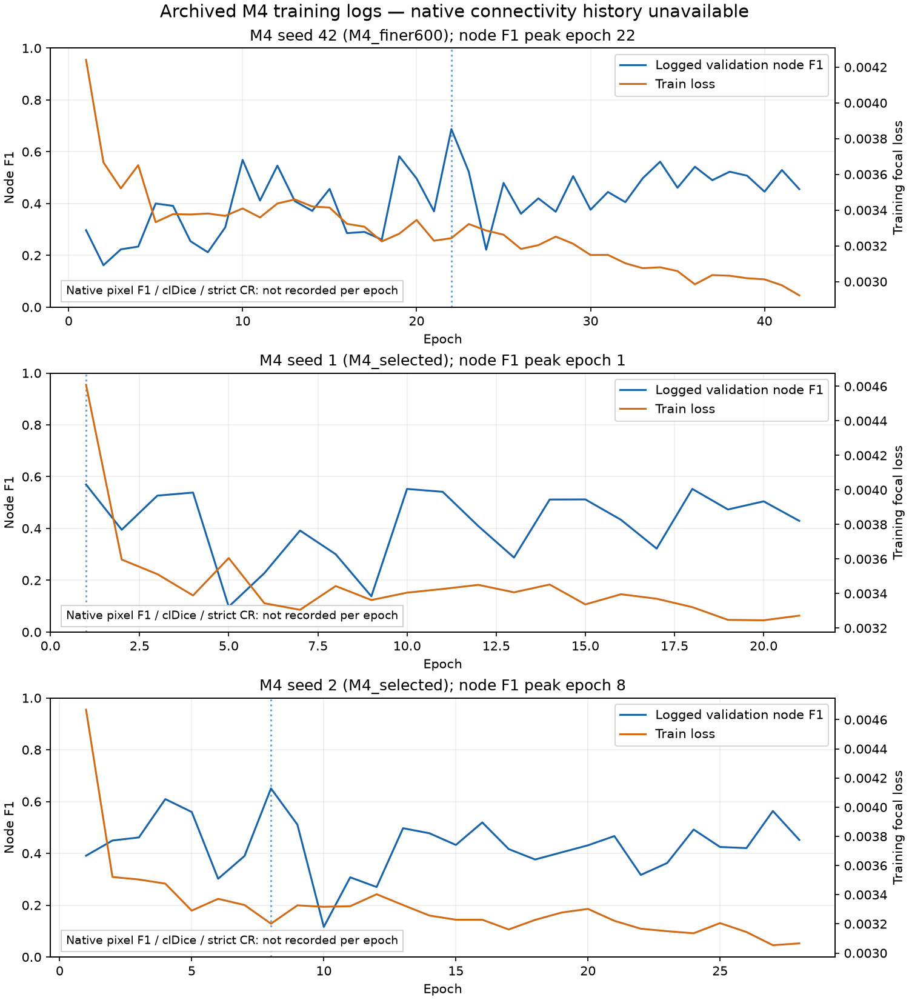

# M4 training fix — partial report

**Stopped before retraining or held-out evaluation: no eligible second public crack dataset is available inside the repository.** This follows hard rule 2. No new empirical support for either pre-registered claim was obtained.

Claims were written to `claim.md` before this audit. Existing checkpoints/results were only read. No dataset image or mask was decoded, no model inference was run, and the consumed 237-image DeepCrack test pass was not rerun or used for selection or reported as new evidence.

## Dataset gate

`dataset_inventory.json` records a recursive filesystem inventory, including ignored files and archive member names. Available paired data are DeepCrack (300 training-source pairs and 237 consumed test pairs) and another DeepCrack directory with those same counts. Another directory of the same named dataset does not satisfy the different-dataset requirement.

TITS has 94 cached graphs and 100 superpixel maps, plus one test graph/map. The preprocessing source saves node features/labels and segment maps; it does not preserve the original RGB images and native masks needed for the requested M4/M2/DeepCrack comparison. Source paths point outside the repository to `C:/Users/ragha/Downloads/CrackDataset/TITS`; no external data was selected or accessed. RoadNet assets are figures and demo examples; its dataset directory is absent. `images.zip` contains figures only.

## Diagnosis from archived logs

The historical trainer's `val_f1` concatenates graph-node labels and argmax predictions. It is **node F1**, not native-resolution pixel F1. The three selected focal/600-segment M4 checkpoints peak at epochs **22, 1, 8** for seeds **42, 1, 2**. The stated 1/3/8 history does not match the actual final selected M4 lock; epoch 3 belongs to several rejected seed-42 WCE trials.

Per-epoch native pixel F1, clDice and strict CR were never logged. Checkpoints were saved only on node-F1 improvements, so a complete connectivity history cannot be reconstructed for unsaved epochs. Whether connectivity continues improving after the pixel-F1 peak is **unknown**. Missing metrics are explicitly labeled in the plot rather than fabricated.

Training loss and node F1 share the epoch axis, with separate scales. `diagnosis.json` and per-seed epoch JSON files preserve the exact logged values.

| Seed | Run | Logged epochs | Node F1 peak epoch | Peak node F1 | Native pixel F1 / clDice / strict CR peak |
| --- | --- | --- | --- | --- | --- |
| 42 | M4_finer600 | 42 | [22] | 0.687285 | Unavailable |
| 1 | M4_selected | 21 | [1] | 0.569592 | Unavailable |
| 2 | M4_selected | 28 | [8] | 0.650715 | Unavailable |

## Archived validation reference

These are the previously locked processed M4 validation results, provided solely as baseline provenance. They are neither before/after results from this task nor held-out evidence. There are no new validation trials or winners.

| Seed | Validation strict CR | Validation clDice | Validation pixel F1 |
| --- | --- | --- | --- |
| 42 | 0.420382 | 0.665982 | 0.595944 |
| 1 | 0.382166 | 0.657830 | 0.627553 |
| 2 | 0.382166 | 0.656874 | 0.590246 |

The seed-42 split is frozen in `frozen_split.json`: 210 train / 45 validation / 45 unused. Training randomness seeds would be 42, 1, 2. Historical configs, thresholds and frozen grids are preserved as references, but `locked_configs.json` explicitly records **no new lock**.

## Metrics and compute

The required inference protocol remains 256×256 model input with native-resolution scoring. Strict CR counts every 8-connected GT component, requires at least 50% GT-pixel coverage, and requires exactly one connected component of the GT/prediction intersection. It aggregates preserved/total components across images. The earlier paper_v2 topology metric excludes components below 20 pixels and accepts coverage by one predicted component without requiring a connected intersection. These definitions differ; a bridge outside GT may improve prediction connectivity without improving strict CR.

clDice is the mean per-image skeleton overlap score with the historical empty-mask convention. Pixel F1 pools TP/FP/FN across images. Size bins remain [0,50), [50,200), [200,inf), in native GT-component area pixels.

Historical compute references follow; these are unchanged-architecture provenance, not measurements on a fresh dataset. Both GFLOPs columns use 2×MACs; the analytic graph estimate includes attention matrix products omitted by some fvcore operators. Costs exclude CPU morphology and input-dependent graph preprocessing.

| Model | Actual graph nodes | Actual directed edges | GFLOPs fvcore | GFLOPs analytic graph estimate |
| --- | --- | --- | --- | --- |
| M4 | 676 | 6902 | 0.112832512 | 0.390120404 |
| M2+M4 | 676+289 | 6902+2956 | 0.118899200 | 0.396506172 |
| M2 | 289 | 2956 | 0.006066688 | 0.006385768 |
| DeepCrack raw | CNN 256×256 | — | 40.178679808 | not applicable |
| DeepCrack processed | CNN 256×256 | — | 40.178679808 | not applicable |

| Historical model | Parameters |
| --- | --- |
| M4 | 116802 |
| M2+M4 | 127428 |
| M2 | 10626 |
| DeepCrack raw | 14720389 |
| DeepCrack processed | 14720389 |

## Negative findings and skipped work

- The repository does not contain a usable independent dataset for the mandatory confirmation pass.
- Historical logs do not test the delayed-connectivity hypothesis: all three requested native per-epoch metrics are absent.
- The prompt's reported epoch peaks and pixel-F1 checkpoint rule conflict with the final selected run artifacts and trainer source.
- Selection-fix, augmentation, lower-LR/warmup trials, three-epoch timing gates, winner selection and seed retraining were skipped under the dataset stop rule.
- Optional M2 retraining, validation hysteresis trade-off sweeps, held-out raw/processed tables, small-crack confirmation, sample SD and validation-minus-held-out gaps were skipped. No held-out values exist to summarize; old consumed-test numbers are not substituted.
- No new training run failed because none was started. Operational lookup/launcher failures and resolutions are recorded in `trial_records.json`.

## Pre-registered verdicts

**Claim 1 — inconclusive (not supported by this experiment).** No connectivity-selected M4 was trained and no independent confirmation was permitted. Historical node-F1 logs cannot establish how native clDice or strict CR evolved after a pixel-F1 peak. The hypothesis remains untested; no positive claim is made.

**Claim 2 — inconclusive (not supported by this experiment).** No fresh raw-M4/raw-DeepCrack or processed-M4/processed-DeepCrack comparison was run, and [0,50) connectivity has no new held-out result. Historical model costs do not establish fresh-data accuracy. This task makes no claim that M4 matches or beats raw or processed DeepCrack.

## Artifacts and reproduction

`claim.md`, `dataset_inventory.json`, `diagnosis.json`, `diagnosis/`, `frozen_split.json`, `historical_validation.json`, `historical_config_reference.json`, `locked_configs.json`, `trial_records.json`, `checkpoint_manifest.json`, `historical_compute_reference.json`, `source_manifest.json`, and `execution.json` record this partial audit. Checkpoint hashes are verified against the old lock. `REPRODUCE.ps1` reproduces only this metadata audit into a fresh timestamped output; it cannot train or evaluate.

The audit script intentionally has no model-loading, training, threshold-search or held-out path. To undertake the original full experiment, the missing eligible dataset prerequisite must first be resolved by the user; this report does not silently relax that rule.

## Verification and wall time

All historical source hashes remained unchanged. All 11 listed archived checkpoint hashes match the previous experiment manifest; the three selected checkpoints also match its final lock. Every generated JSON parses, no new checkpoint exists, and the diagnosis plot was visually checked. Total session wall time through verification: 338.4 seconds (5.64 minutes), including implementation and inspection; metadata-audit execution itself: 3.983 seconds. Training/inference/held-out wall time: zero.
