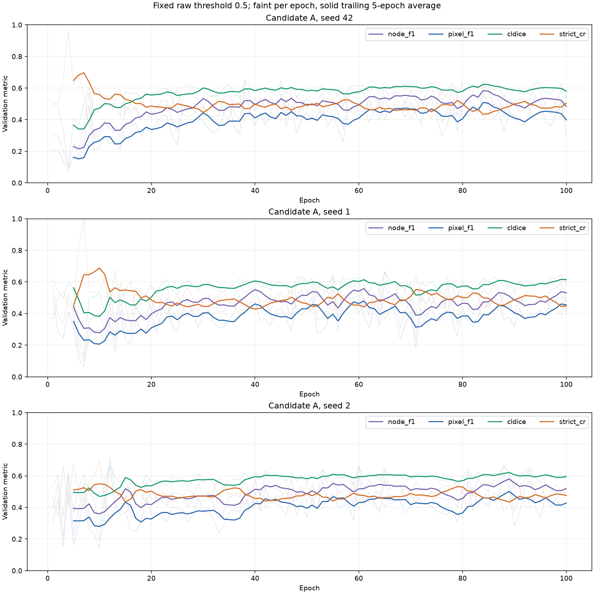
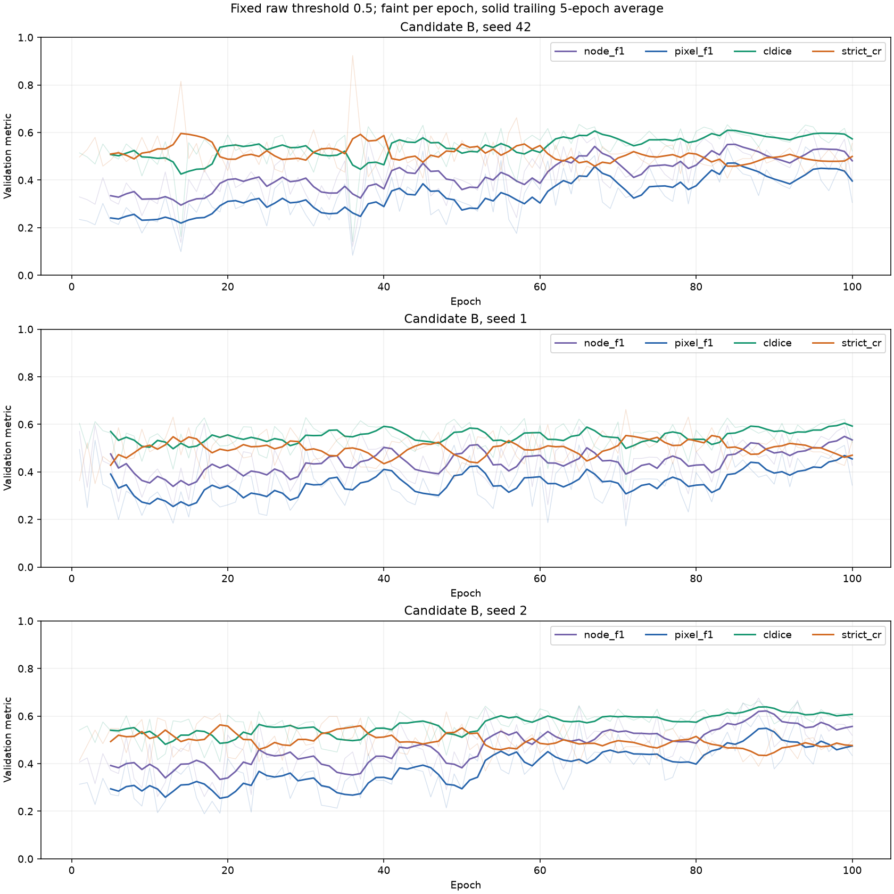
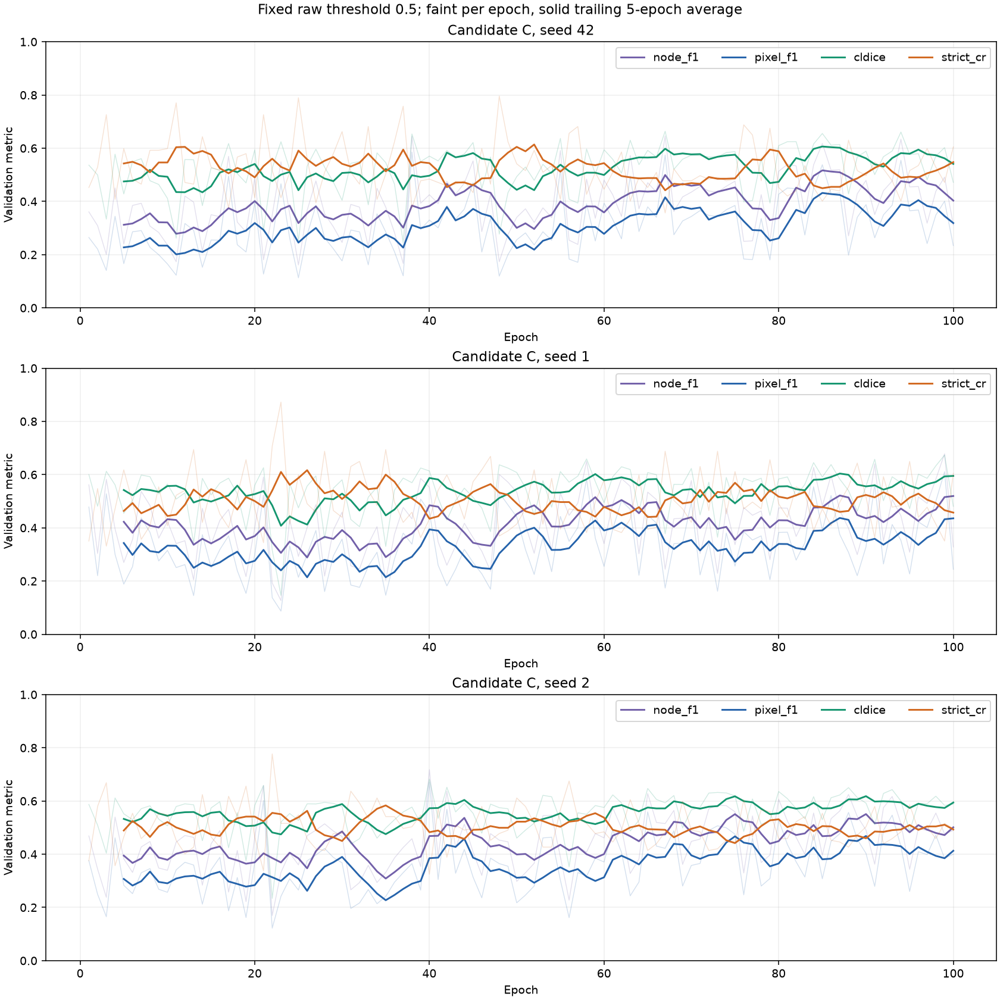
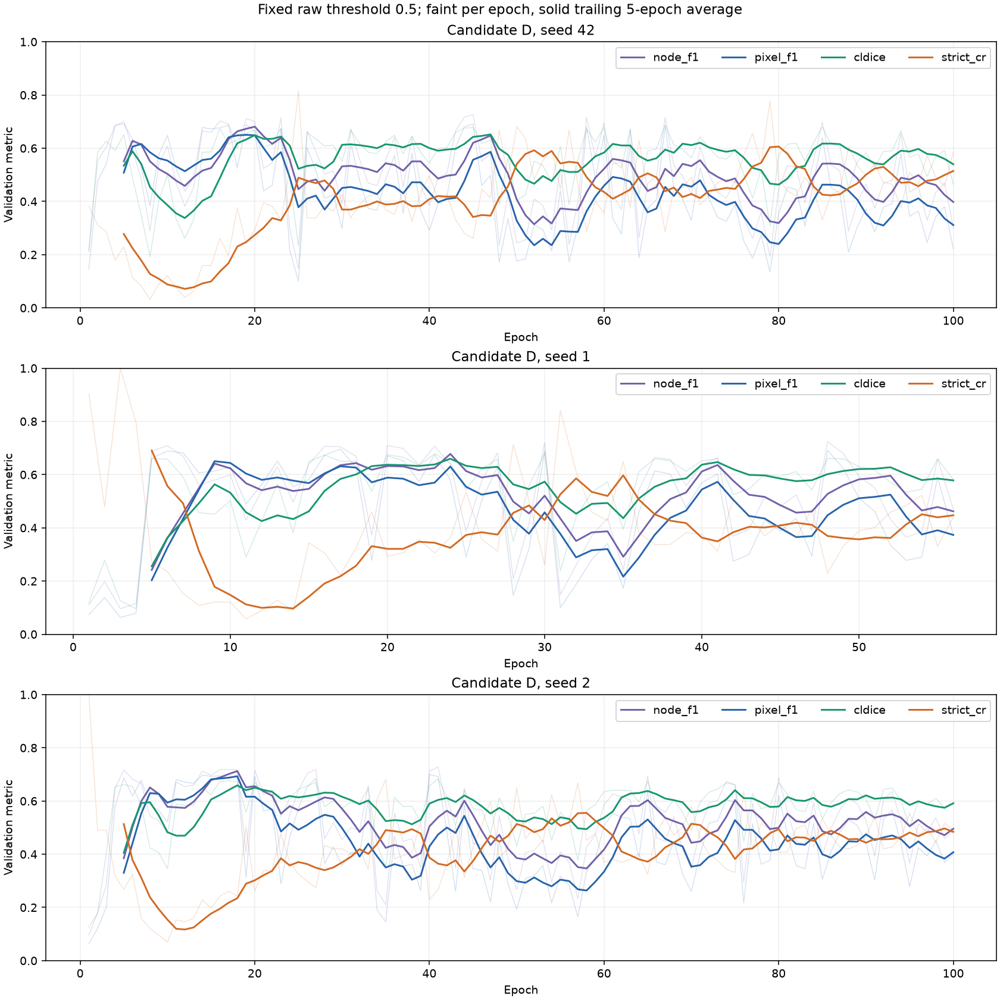

# M4 stabilization v2 results

**Status: partial / failed**. Preregistered claims are in `claim.md`. Every selection uses the frozen 210/45/45 DeepCrack seed-42 split; training seeds change randomness only. The consumed 237-image DeepCrack test was never evaluated or used as new evidence.

Reason: Nine-hour budget cannot fit next mandatory operation (0.0s)

## Dataset provenance

TITS: 269 source images, 66 uniquely paired annotated native masks across five sensor groups. Supplied layout: `IMAGES/<sensor>, GROUND_TRUTH/<sensor>, RESULTS/<sensor>; no train/test directories in supplied data`. All 66 annotated pairs form the locked cohort; unannotated images are excluded. No TITS-finetuned checkpoints are used. Grayscale images are promoted to three identical channels. Eight masks have larger native dimensions than their source images; inference remains 256×256 and probabilities are projected to native GT size. Black pixels are cracks. No byte duplicate was found against the 300 DeepCrack training-source images. The external folder is read-only; hashes and metadata are recorded.

DeepCrack source-ID overlap exists between train and validation/test in the historical source audit, despite fixed membership. Validation is therefore not claimed to be source-independent; this study does not silently repair or reshuffle the split.

## Fixed-epoch diagnosis

All mandatory candidate runs use 100 epochs with no early stopping. Native pixel F1, clDice and strict CR are logged each epoch at raw threshold 0.5, plus node F1 on historical native training graphs. Epoch selection uses the trailing five complete epochs of (clDice + strict CR)/2, retaining the endpoint weights, with the earliest epoch winning ties. Checkpoints include every tenth and final epoch and each improving smoothed selection.

A retains the historical five-epoch warmup and node-F1 ReduceLROnPlateau schedule, but disables early stopping. B combines effective-batch-8 gradient accumulation with cosine LR 1e-3 to 1e-5. C adds an eight-view deterministic augmented graph bank shared across seeds; a random cached view per training source is chosen each epoch. D adds EMA parameters at decay 0.99 after each optimizer step, copying current BatchNorm buffers. Accumulation retains one graph per forward (including per-graph BatchNorm); the final two-graph group is normalized by two.

| Candidate | Seed | Node F1 peak | Pixel F1 peak | clDice peak | Strict CR peak | Connectivity peaks after node peak |
| --- | --- | --- | --- | --- | --- | --- |
| A | 42 | 84 | 84 | 84 | 7 | {'cldice': False, 'strict_cr': False} |
| A | 1 | 61 | 61 | 99 | 10 | {'cldice': True, 'strict_cr': False} |
| A | 2 | 89 | 89 | 89 | 10 | {'cldice': False, 'strict_cr': False} |
| B | 42 | 85 | 85 | 84 | 14 | {'cldice': False, 'strict_cr': False} |
| B | 1 | 99 | 99 | 99 | 71 | {'cldice': False, 'strict_cr': False} |
| B | 2 | 89 | 89 | 89 | 19 | {'cldice': False, 'strict_cr': False} |
| C | 42 | 85 | 85 | 85 | 52 | {'cldice': False, 'strict_cr': False} |
| C | 1 | 87 | 87 | 87 | 26 | {'cldice': False, 'strict_cr': False} |
| C | 2 | 90 | 90 | 90 | 35 | {'cldice': False, 'strict_cr': False} |
| D | 42 | 20 | 19 | 47 | 80 | {'cldice': True, 'strict_cr': True} |
| D | 1 | 24 | 9 | 24 | 5 | {'cldice': False, 'strict_cr': False} |
| D | 2 | 18 | 18 | 18 | 58 | {'cldice': False, 'strict_cr': True} |

## Validation selection

No complete three-seed candidate selection is available.

## Pre-registered verdicts

**Claim 1: inconclusive.** The inference concerns validation clDice and strict CR only, under the frozen split and three-seed rule. A lower training loss alone does not establish the claim. If no candidate replaces the incumbent this is a negative result; no additional recipe is introduced after results.

**Claim 2: inconclusive.** This verdict compares RAW new M4 against RAW DeepCrack on mean strict CR and small-crack [0,50) connectivity only, at their locked fixed thresholds. Processed results are separate and do not substitute for raw evidence. Zero-shot TITS transfer may hurt every model, and any other metric/model contrast is exploratory.

## Negative results, failures and skipped work

- Optional M2 retraining was skipped; its three historical seed checkpoints and locked recipes are retained.
- Candidate rejections, including before/after means, are recorded in `selection.json` and the validation table.
- Runtime failures (if any) are recorded in `failures.jsonl`; incomplete runs retain all epoch logs and immutable checkpoints.
- No consumed DeepCrack test run, TITS tuning, source split reshuffling or post-confirmation config changes were performed.

## Metric definitions

Strict CR counts all 8-connected GT components, requires at least 50% native GT-area coverage and exactly one connected region in GT∩prediction, and pools preserved/total components across images. Earlier paper_v2 topology excludes components below 20 pixels and accepts coverage by one predicted component without requiring connected GT intersection. Bridging outside GT therefore need not fix strict CR. clDice averages historical per-image skeleton scores with historical empty-mask handling; pixel F1 pools TP/FP/FN. Native size bins are [0,50), [50,200), [200,inf) GT-component area pixels.

## Reproduction and timing

Run `REPRODUCE.ps1` from a fresh preregistered output folder. Per-run exact commands are in `runs/<candidate>/seed_<seed>/command.json`. `protocol.json`, per-run configs, `checkpoint_manifest.json`, source hashes and input hashes record the full settings. Runs cannot overwrite completed or interrupted runs. Held-out confirmation has an exclusive consumed marker and cannot retry. `events.jsonl` and `trial_records.json` include wall times and statuses.
